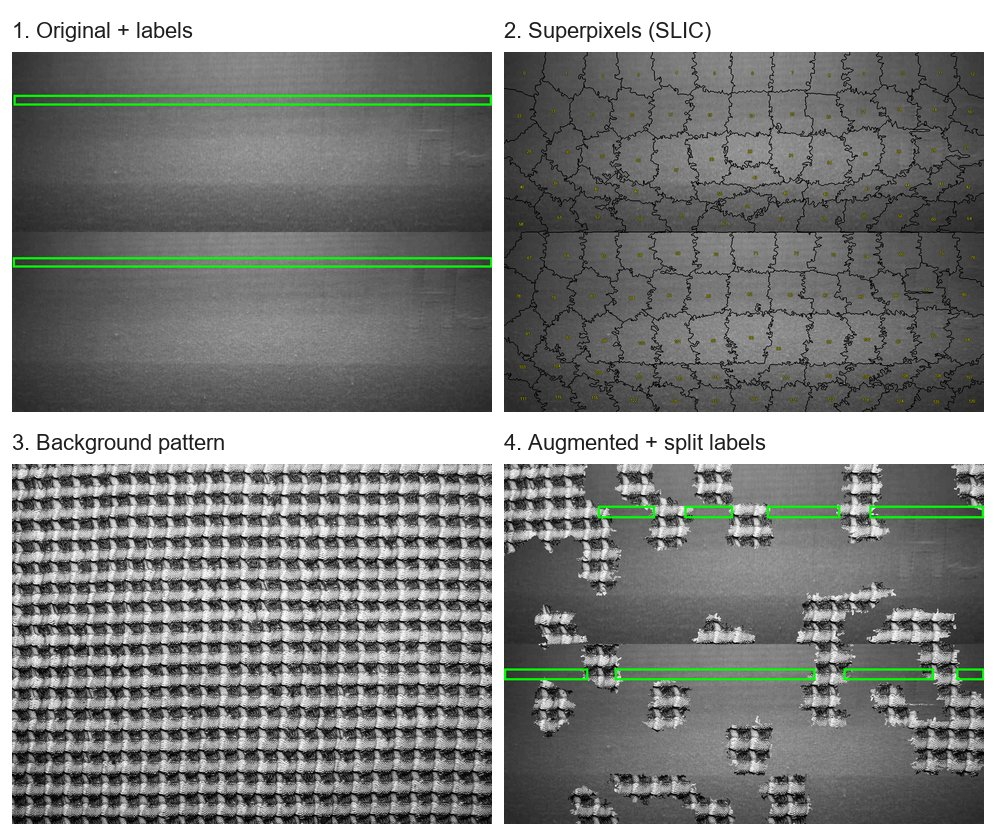
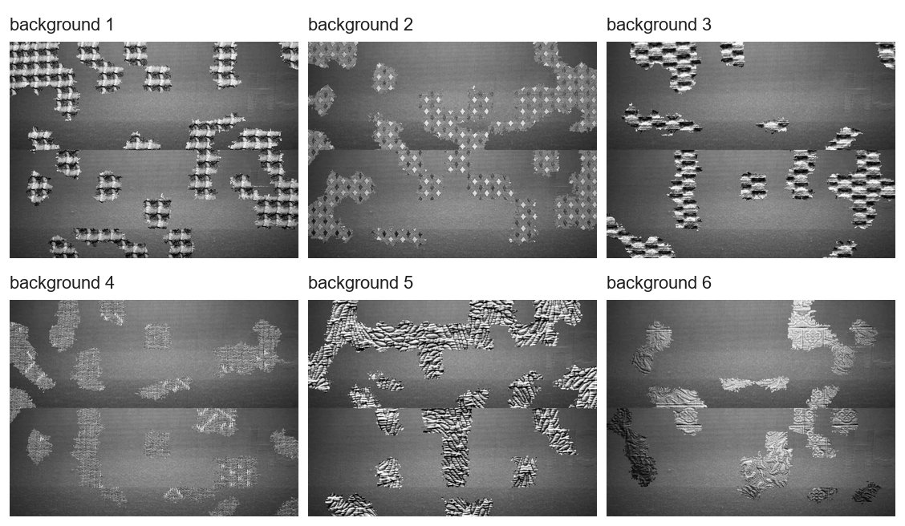
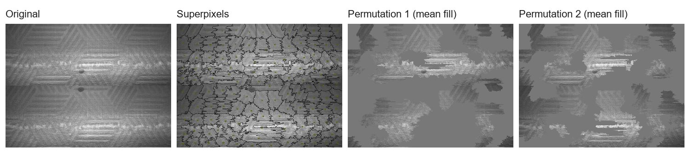

# LIME Augmentation

Superpixel-based data augmentation for **textile defect detection** with YOLO.

Images are split into superpixels (the same segmentation used by [LIME](https://github.com/marcotcr/lime)), and a random subset of them is replaced with a background fabric pattern or a fill colour. When the image has YOLO labels, each bounding box is checked against the replaced area: boxes that are mostly covered are dropped, and boxes that are only partly covered are split into the parts that are still visible.

The result is many new training images per original. The model sees the same defects on different fabric textures and learns to rely on the defect itself rather than the surrounding context.



## How it works

1. **Segment.** The image is split into superpixels with `slic` or `quickshift`. `--superpixel_scale` makes the superpixels bigger or smaller.
2. **Pick a mask.** Each superpixel is replaced with probability `--replacement_prob`. At least one is always replaced.
3. **Replace.** Pixels under the mask come from a background pattern (resized to the image) or from a fill mode (`mean`, `blur`, `noise`, `black`, `white`).
4. **Update labels.** For each YOLO box, the script measures the fraction of the box that was replaced:
   - coverage ≥ threshold: the box is removed (the defect is no longer visible);
   - `augmentation_masks` only: if the box is partly covered, it is split into the visible connected components. Tiny pieces are discarded.
5. **Repeat** `--num_permutations` times **for every background**. Each image gives `num_backgrounds × num_permutations` new samples.

The same image with one permutation per background pattern:



For plain image folders without labels, `augmentation_images` fills the replaced superpixels instead:



## Project structure

```
lime_aug/
├── augmentation_backgrounds.py  # YOLO dataset + background patterns, remove covered boxes
├── augmentation_masks.py        # same, plus split partly covered boxes into visible parts
├── augmentation_images.py       # plain image folder, fill-based permutations (no labels)
├── infrared_grayscale.py        # convert images to an infrared-like grayscale look
├── shuffle_dataset.py           # re-split a YOLO dataset 90/5/5, stratified per class
├── files.py                     # dataset traversal (images/<split> <-> labels/<split>)
├── yolo.py                      # YOLO label I/O, bbox conversion, mask coverage
└── superpixels.py               # image loading, segmentation, masks, debug images
datasets/                        # not versioned (see below)
├── source/                      # original datasets
├── backgrounds/                 # background patterns
└── generated/                   # augmentation outputs
docs/images/                     # README figures
```

## Installation

Requires Python 3.10+.

```bash
git clone https://github.com/itszen7/lime-augmentation.git
cd lime-augmentation
pip install -r requirements.txt
```

## Data layout

The `datasets/` folder is not in the repository. Put your data there using the standard YOLO layout:

```
datasets/source/<dataset>/
├── data.yaml
├── images/{train,val,test}/*.jpg
└── labels/{train,val,test}/*.txt     # class x_center y_center width height (normalised)
```

Background patterns are plain image folders, for example `datasets/backgrounds/ir_backgrounds/pattern1.png`.

The defect classes used in this project are:

| id | class         |
|----|---------------|
| 0  | `fio-cor-dif` |
| 1  | `oleo`        |
| 2  | `trama`       |
| 3  | `vertical`    |

## Usage

Run every script from the repository root with `python -m lime_aug.<script>`. Add `--help` to list all options.

### Background replacement, splitting partly covered boxes

```bash
python -m lime_aug.augmentation_masks \
  --dataset_folder datasets/source/smartex \
  --backgrounds_folder datasets/backgrounds/ir_backgrounds \
  --output_folder datasets/generated/irmaskset \
  --num_permutations 2 --segmentation slic --replacement_prob 0.25 --superpixel_scale 1 \
  --cover_threshold 0.3 --trama_class 2 --cover_threshold_trama 0.95 \
  --min_component_pixels 200 --min_component_w_px 4 --min_component_h_px 4 \
  --component_pad_px 2 --connectivity 2 \
  --original --save_debug_superpixels --verbose
```

| Option | Default | Description |
|---|---|---|
| `--num_permutations` | 5 | Permutations per background, per image |
| `--cover_threshold` | 0.3 | Remove a box when this fraction of it is replaced |
| `--trama_class` / `--cover_threshold_trama` | `trama` / 0.6 | Separate threshold for the long, thin `trama` defects |
| `--min_component_pixels`, `--min_component_w_px`, `--min_component_h_px` | 200, 4, 4 | Discard visible pieces smaller than this |
| `--component_pad_px` | 2 | Padding added around each split box |
| `--connectivity` | 2 | 1 = 4-connected, 2 = 8-connected components |
| `--original` | off | Also copy the original image and labels to the output |

### Background replacement, removing covered boxes

```bash
python -m lime_aug.augmentation_backgrounds \
  --dataset_folder datasets/source/smartex \
  --backgrounds_folder datasets/backgrounds/backgroundz \
  --output_folder datasets/generated/permtex \
  --num_permutations 5 --cover_threshold 0.30 --segmentation slic \
  --replacement_prob 0.25 --superpixel_scale 1 --save_debug_superpixels --verbose
```

### Permutations of a plain image folder

```bash
python -m lime_aug.augmentation_images \
  --images_folder datasets/source/new_defects \
  --output_folder datasets/generated/permdef \
  --num_permutations 5 --segmentation slic --replacement_prob 0.5 \
  --fill_mode mean --save_debug_superpixels
```

`--fill_mode` can be `mean`, `blur` (with `--blur_radius`), `noise`, `black` or `white`. Use `--recursive --preserve_structure` for nested folders.

### Utilities

```bash
# Infrared-like grayscale conversion
python -m lime_aug.infrared_grayscale --input <images> --output <images_ir> --recursive --style enhanced --out-format png

# Re-split a dataset 90/5/5, keeping per-class ratios (supports multi-label images)
python -m lime_aug.shuffle_dataset \
  --dataset datasets/generated/irmaskset \
  --output datasets/generated/irmaskset_shuffled \
  --data-yaml datasets/source/smartex/data.yaml
```

## Outputs

The augmentation scripts write a YOLO dataset with the same splits:

```
<output_folder>/
├── images/<split>/<stem>_bg000_perm000.jpg
├── labels/<split>/<stem>_bg000_perm000.txt
├── debug_perm_bboxes/<split>/...    # boxes drawn: green = kept, red = removed
└── debug_superpixels/<split>/...    # with --save_debug_superpixels
```

Images whose boxes were all removed still get an empty `.txt`, so they work as valid background samples for YOLO. Runs are reproducible with `--seed`.
